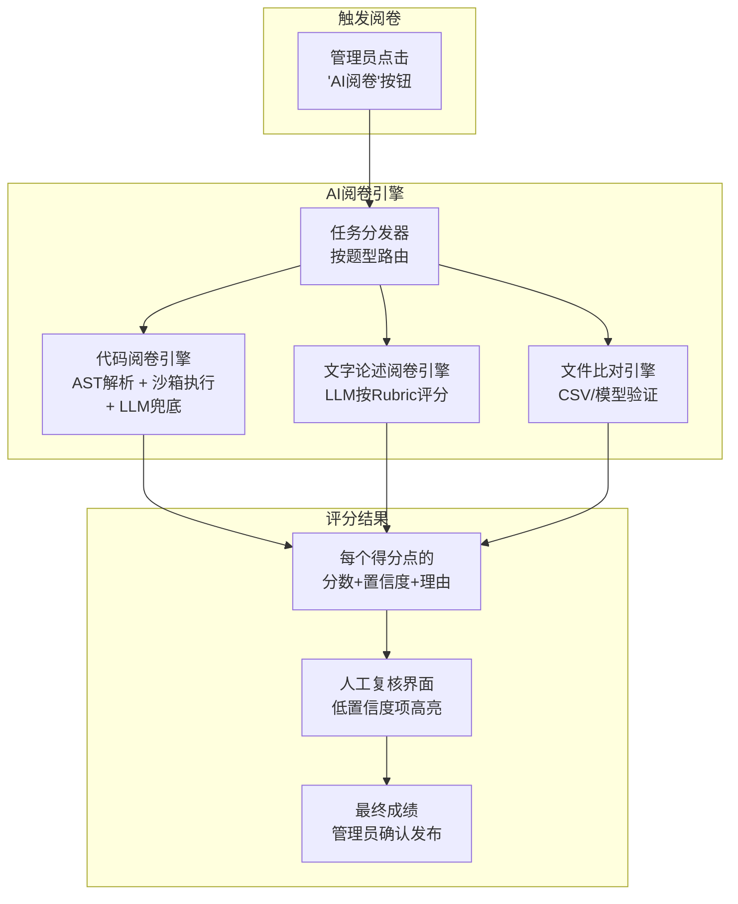
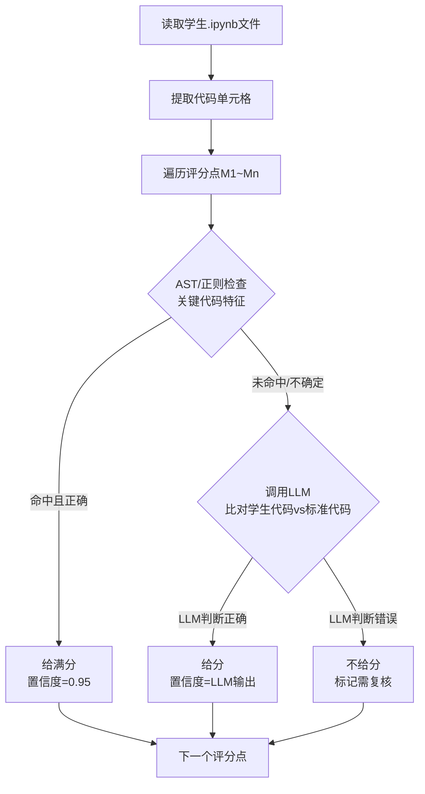
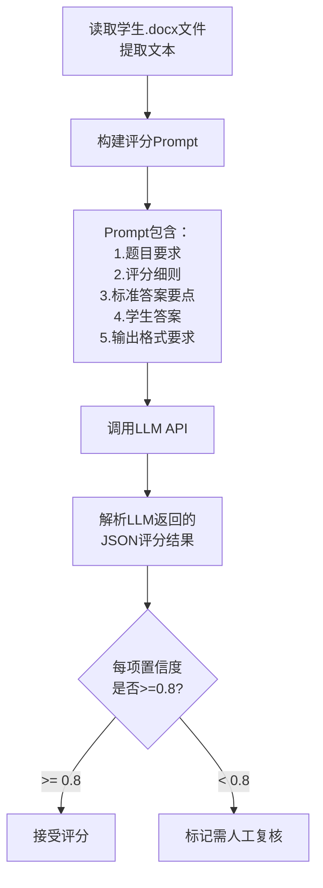

# AI阅卷系统实施方案

## 1. 项目背景

现有模拟考试系统（mock-exam）支持考生在线答题和文件上传，但**没有任何评分功能**：
- 数据库 `student_answers` 表无分数字段
- 后端无判分逻辑
- 管理员只能手动查看答案和参考答案对照阅卷

考试内容为"AI训练师三级/高级实操题"，共8大类40道题，每份卷子抽取部分题目，答题形式包括Python代码补全（.ipynb）、文字论述（.docx）、截图（.jpg）、数据文件（.csv）、模型文件（.pkl）。

## 2. 方案总览

采用 **"规则引擎 + LLM API"混合方案**，工作模式为 **"AI初评 + 人工复核"**。



## 3. 题型与阅卷策略映射

| 模块 | 题型 | 提交物 | 阅卷策略 | AI参与度 |
|------|------|--------|---------|---------|
| 1.1.x 数据处理流程 | Python代码补全 | .ipynb + .jpg + .csv | AST检查 + 沙箱执行 + LLM兜底 | 中（LLM只在兜底时介入） |
| 1.2.x 模块效果优化 | 文字论述 | .docx | LLM按Rubric评分 | 高 |
| 2.1.x 数据清洗标注 | Python代码 + 文字 | .ipynb + .docx | 混合（代码用规则，文字用LLM） | 中 |
| 2.2.x 模型开发测试 | Python代码 + 报告 | .ipynb + .pkl + .docx | 代码执行 + 模型测试 + LLM评报告 | 中高 |
| 3.1.x 数据分析优化 | 分析报告 | .docx | LLM评分 | 高 |
| 3.2.x 交互流程设计 | Python代码 + 文字 | .ipynb + .docx | 混合 | 中 |
| 4.1.x 培训大纲编写 | 文字论述 | .docx | LLM评分 | 高 |
| 4.2.x 采集处理指导 | 文字论述 | .docx | LLM评分 | 高 |

## 4. 技术架构

### 4.1 后端新增模块（fapi/）

```
fapi/
├── routers/
│   └── grading.py          # 阅卷API路由（新增）
├── services/
│   ├── grading_engine.py    # 阅卷引擎主调度（新增）
│   ├── code_grader.py       # 代码阅卷（AST + 执行）（新增）
│   ├── text_grader.py       # 文字论述阅卷（LLM）（新增）
│   ├── file_grader.py       # 文件比对阅卷（新增）
│   └── llm_client.py        # LLM API统一调用层（新增）
├── models.py                # 新增评分相关表（修改）
```

### 4.2 数据库新增表

**grading_rubrics（评分细则表）**：存储每道题的标准答案和评分要点
- `id`, `question_id`（关联questions表）
- `rubric_items`（JSON）：结构化的评分点列表，每项包含：编号、描述、分值、判分类型（code/text/file）、标准答案片段、关键词列表
- `total_score`：该题总分
- `grading_type`：题型标识（code/text/mixed）

**grading_results（阅卷结果表）**：存储AI评分结果
- `id`, `student_answer_id`（关联student_answers表）
- `question_id`, `student_exam_id`
- `ai_score`：AI给的总分
- `final_score`：人工确认后的最终分数（可为空）
- `item_scores`（JSON）：每个得分点的详细评分，结构如下：
  ```json
  [
    {
      "item_id": "M1",
      "max_score": 2,
      "ai_score": 2,
      "confidence": 0.95,
      "reason": "代码中正确使用了pd.read_csv()读取数据集",
      "method": "ast_match",
      "needs_review": false
    },
    {
      "item_id": "M5",
      "max_score": 3,
      "ai_score": 2,
      "confidence": 0.6,
      "reason": "代码使用了条件判断但写法与标准答案不同，逻辑基本正确但边界条件可能有误",
      "method": "llm_review",
      "needs_review": true
    }
  ]
  ```
- `status`：`pending` / `ai_graded` / `reviewed` / `finalized`
- `reviewed_by`：复核管理员ID
- `reviewed_at`：复核时间

**student_exams表修改**：新增字段
- `ai_total_score`：AI评分总分
- `final_total_score`：最终确认总分
- `grading_status`：`not_graded` / `ai_grading` / `ai_graded` / `reviewed`

### 4.3 LLM API调用层

统一封装在 `llm_client.py` 中，支持多个模型提供商：

**推荐模型优先级**（服务器在阿里云）：
1. **DeepSeek-V3**（首选）：通过 DeepSeek API 调用，价格最低，能力强
2. **通义千问 Qwen-Max**（备选）：阿里云原生服务，网络延迟最低
3. **GPT-4o-mini**（备选）：OpenAI API

配置方式：环境变量指定模型和API Key，支持运行时切换。

### 4.4 阅卷引擎详细流程

**代码题阅卷流程：**



**文字论述题阅卷流程：**



## 5. 准确率预估

### 5.1 按题型预估

| 题型 | 判分方法 | 得分点准确率 | 总分偏差（25分制） | 说明 |
|------|---------|------------|-----------------|------|
| **代码补全题**（1.1.x等） | AST + 执行 + LLM兜底 | **90-93%** | 约1-2分 | 大部分得分点可通过AST确定性判断 |
| **文字论述-有模板**（1.2.x, 4.x） | LLM按Rubric | **80-88%** | 约2-3分 | PDF已提供答题模板和关键词 |
| **文字论述-开放性**（3.1.x） | LLM综合评分 | **70-80%** | 约2-4分 | 主观性最强，准确率最低 |
| **模型开发题**（2.2.x） | 执行验证 + LLM评报告 | **85-90%** | 约2-3分（35分制） | 代码部分客观，报告部分主观 |
| **文件产出物**（CSV/PKL） | 数据比对/模型测试 | **95-98%** | 几乎无偏差 | 纯客观比对 |

### 5.2 综合准确率

- **单个得分点判断准确率**：约 85-88%
- **单份卷子总分偏差**：约 2-4分（满分25分的8-16%）
- **需人工复核的得分点比例**：约 15-25%（置信度低于阈值的）

### 5.3 在"AI初评+人工复核"模式下的效果

| 指标 | 预估值 |
|------|--------|
| 管理员阅卷效率提升 | 60-70%（只需复核标记项，而非逐题阅卷） |
| 人工复核后最终准确率 | 98%+（AI初评 + 人工纠偏） |
| 每份卷子平均人工复核时间 | 3-5分钟（原来可能需要15-20分钟） |

## 6. API调用成本估算

### 6.1 单份卷子Token消耗

| 阅卷任务 | LLM调用次数 | 输入token/次 | 输出token/次 | 小计 |
|---------|------------|-------------|-------------|------|
| 代码题LLM兜底（约3-4个得分点） | 4次 | ~2,000 | ~500 | 输入8K + 输出2K |
| 文字论述题（每道题1次） | 4次 | ~3,000 | ~1,000 | 输入12K + 输出4K |
| 模型报告评估 | 1次 | ~3,000 | ~800 | 输入3K + 输出0.8K |
| **单份卷子合计** | **~9次** | | | **输入~23K + 输出~7K** |

### 6.2 各模型单份卷子成本

| 模型 | 输入价格 | 输出价格 | 单份卷子成本 |
|------|---------|---------|------------|
| **DeepSeek-V3**（推荐） | ¥1/百万token | ¥2/百万token | **¥0.04（4分钱）** |
| 通义千问 Qwen-Max | ¥2/百万token | ¥6/百万token | ¥0.09（9分钱） |
| GPT-4o-mini | $0.15/百万token | $0.6/百万token | ¥0.06（6分钱） |
| GPT-4o | $2.5/百万token | $10/百万token | ¥0.90（9毛钱） |

### 6.3 批量阅卷成本（使用DeepSeek-V3）

| 阅卷规模 | API费用 | 耗时预估 |
|---------|---------|---------|
| 50份卷子 | **¥2** | ~10分钟 |
| 100份卷子 | **¥4** | ~20分钟 |
| 500份卷子 | **¥20** | ~1.5小时 |
| 1000份卷子 | **¥40** | ~3小时 |

注：耗时主要取决于API并发限制和网络延迟，可通过异步并发优化。

## 7. 数据隐私保护

- 调用LLM API时，**不传输考生姓名、准考证号、身份证号等个人信息**
- 仅传输脱敏后的答案内容（代码文本、论述文字）和评分细则
- API请求中使用内部ID标识，不关联任何个人身份
- 代码执行、文件比对等操作全部在服务器本地完成，不经过外部API

## 8. 前端交互设计

### 8.1 管理端新增页面

**阅卷管理页**：在考试的学生列表页增加"AI阅卷"功能
- "批量AI阅卷"按钮：对所有已提交的考生触发AI评分
- 阅卷状态列：显示 未评分 / AI评分中 / 待复核 / 已确认
- AI评分列：显示AI给出的分数

**评分详情/复核页**：点击某个考生进入
- 左侧：题目内容 + 参考答案
- 中间：考生答案（代码/文字/文件预览）
- 右侧：AI评分详情（每个得分点的分数、置信度、评分理由）
- 低置信度项用黄色高亮，提示管理员重点复核
- 管理员可修改每个得分点的分数
- "确认评分"按钮：锁定最终成绩

## 9. 实施步骤

| 阶段 | 内容 | 工作量预估 |
|------|------|-----------|
| Phase 1 | 数据库扩展（新增评分表和字段）+ LLM调用层封装 | 1-2天 |
| Phase 2 | 评分细则录入系统（管理端录入/导入标准答案和评分点） | 2-3天 |
| Phase 3 | 代码阅卷引擎（AST解析 + LLM代码比对） | 3-4天 |
| Phase 4 | 文字论述阅卷引擎（LLM Rubric评分） | 2-3天 |
| Phase 5 | 文件比对引擎（CSV比对、模型测试） | 1-2天 |
| Phase 6 | 管理端阅卷界面 + 人工复核界面 | 3-4天 |
| Phase 7 | 联调测试 + Prompt优化 | 2-3天 |
| **总计** | | **约14-21天** |
